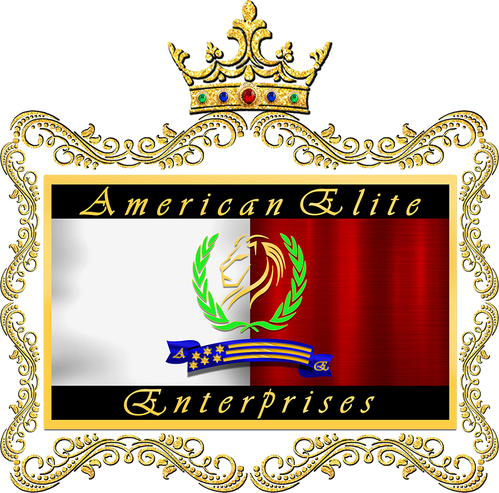
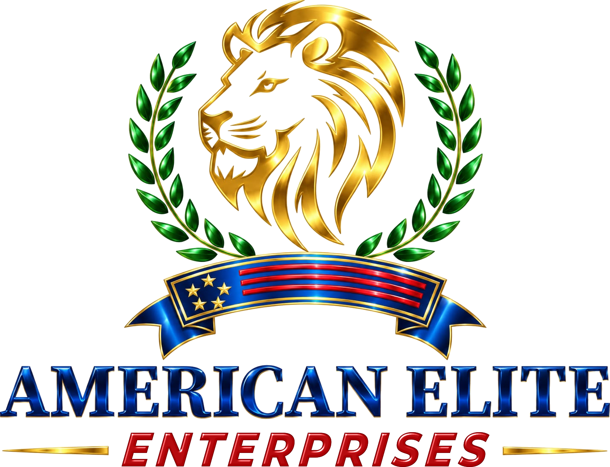
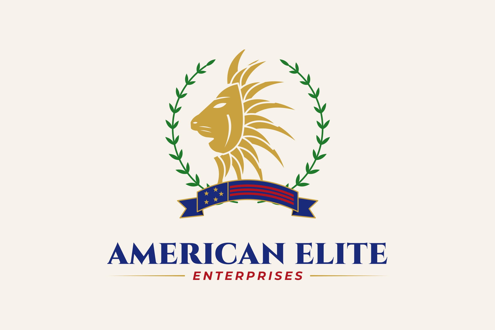

# American Elite Enterprises — logo

## The crest (used on the website)

The website uses the group's **original crest**, unchanged: a jewelled gold crown over an ornate gold frame, enclosing the lion in a laurel wreath, the flag ribbon and "American Elite / Enterprises". It is the logo of the original website (`wp-content/uploads/2023/02/2023-logo-small.png`), kept in `source/original-crest.png`.

**Why.** Dr. Daniel Davidson asked (4 November 2026) for American Elite Enterprises to keep its old, traditional look, because its history and age are part of its value. He also asked that every business keep its own logo and identity: no shared emblem with only the name changed. The redesigned logos below were therefore set aside. Each company's own logo is shown on the website; see `docs/company-logos.md`.

**Where it appears:**
- header and footer: the crest beside the name, set in Cinzel (classical Roman capitals);
- About page, centre of the homepage orbit and the Open Graph image;
- Organization structured data;
- favicons and apple icon.

`source/export-company-logos.cjs` writes the crest's website files: `public/brand/american-elite-crest.png` and `american-elite-crest-sm.webp`, plus `src/app/icon1.png`, `icon2.png` and `apple-icon.png`.

**Possible light refresh (not done).** The client allowed "a bit more refreshed if needed". The source is a 1000px raster image. A designer could redraw it as vector art in the same design, which would keep the look while making it sharp at every size and usable in print.

## Metallic logo (not used — declined by the client)

`logo-metallic/` holds a logo that was briefly used on the website and then declined by the client. Do not run `source/export-metallic-web.cjs`: it would overwrite the crest favicons. It is the **American Elite Digital** artwork (gold lion, laurel wreath, flag ribbon and blue "AMERICAN ELITE") with "DIGITAL" replaced by **"ENTERPRISES"** in matching glossy red italic. The gold rules on either side are shortened to fit the longer word. Everything except that bottom line is the Digital artwork, unchanged.

| File | Size | Use |
| --- | --- | --- |
| `lockup-full.png` | 1431×1099 | Stacked logo: documents, structured data |
| `lockup-horizontal.png` | 1600×353 | Emblem beside the wordmark: header, footer |
| `lockup-horizontal-on-dark.png` | 1600×353 | Same, with a chrome wordmark for navy or dark backgrounds |
| `emblem.png` | 851×848 | Lion, laurel and ribbon without the name |
| `wordmark.png` / `wordmark-on-dark.png` | 1431×241 | Name only |

All files are transparent PNGs.

**How it was made.** The Digital logo is a raster image (the designer's JPEG, turned into a transparent PNG by the Digital site's build script), not vector art.
1. `source/build-metallic-logo.cjs` starts from that PNG (`source/digital-lockup-full.png`) and clears the "— DIGITAL —" line.
2. It sets "ENTERPRISES" with `source/metal-text.cjs` and puts the gold rules back.
3. It cuts the emblem, wordmark and lockups the same way the Digital site does.

The lettering is Montserrat ExtraBold Italic, condensed and slanted a little further. It is filled with a colour profile sampled row by row from the original "DIGITAL", with an SVG bevel and specular-light filter for the shine. To calibrate it, "DIGITAL" itself was rendered and compared side by side with the original.

**Limits (please read):**
- **Web quality only.** It is a raster image about 1400px wide. It is fine on screens, but it will blur if enlarged for print, signage or embroidery. For those uses, ask the designer of the Digital logo for the vector source (AI, EPS or SVG) and have "ENTERPRISES" set in it.
- **Close, not identical.** The exact typeface of the original red lettering is not known. At normal sizes the match is close, but a designer comparing them side by side could tell the difference.
- **Permission.** The emblem and the "AMERICAN ELITE" lettering are the Digital logo's artwork. Confirm the company may reuse it, for example because both companies own it or the designer's licence allows it.

**Regenerating.**
1. In a separate folder, run `npm i sharp@0.33.5 opentype.js@1.3.4 @fontsource/montserrat@5.1.0`.
2. Put that folder's `node_modules` on `NODE_PATH`.
3. Run `node source/build-metallic-logo.cjs`. This writes `logo-metallic/`.
4. Run `node source/export-metallic-web.cjs`. This writes the website files: `public/brand/american-elite-lockup.png`, `american-elite-emblem.png`, `american-elite-emblem-sm.webp` and `american-elite-logo.png`, plus `src/app/icon1.png`, `icon2.png` and `apple-icon.png`.

## Flat vector logo (not used — set aside)

The redesigned logo for American Elite Enterprises, built in the same family as the **American Elite Digital** mark (lion, laurel wreath, flag ribbon, Roman-capital wordmark) and drawn as flat, scalable vector art.

## Files

`logo/svg/` — master artwork (transparent, type converted to outlines; use these for print and signage)
`logo/png/` — 2400×1600 presentation renders on their intended background
`logo/favicon/` — app/browser icons (16–512px)

| Version | File stem | Use |
| --- | --- | --- |
| Stacked (primary) | `american-elite-stacked-*` | Default — website hero, documents, signage |
| Horizontal | `american-elite-horizontal-*` | Headers, letterheads, wide spaces |
| Emblem | `american-elite-emblem-*` | Lion + laurel + ribbon without the name |
| Mark | `american-elite-mark-*` | Lion head alone — social avatar, app icon, stamps |
| Wordmark | `american-elite-wordmark-*` | Name only, where the emblem appears separately |

Each comes in `-light` (on ivory/white), `-dark` (on navy), `-mono` (one colour, royal blue) and `-mono-reverse` (one colour, ivory on dark). One-colour versions use transparent knock-outs, so they work on any background, and are suitable for embossing, foil, engraving and single-colour print.

Favicons: sizes up to 48px use a reduced-detail lion (fewer, broader mane strands) so it stays legible; 180px and above use the full lion.

## Step 1 — analysis of the original crest

**Elements:** jewelled gold crown; ornate baroque gold frame; black bars with gold script "American Elite" / "Enterprises"; a white | crimson split field; a faceted gold lion head in profile inside a green laurel wreath; a royal-blue ribbon with gold stars and stripes and "A" / "E" on the ends.

**Measured palette (from the file's pixels):**

| Element | Hex |
| --- | --- |
| Gold (frame, crown) / highlights | `#F1C23B` / `#FFD451` |
| Crimson field / crown jewel | `#870001` / `#C80012` |
| White field / shading | `#F5F5F5` / `#C0C0C0` |
| Black bars | `#000000` |
| Laurel green / green jewel | `#1DED27` / `#00AE4C` |
| Ribbon blue / blue jewel | `#0807B2` / `#002BB1` |

**What weakened it:** glitter, bevel and gradient effects; about seven competing hues; a filigree frame that turns to noise below about 200px; script lettering that is hard to read and locked inside the emblem; neon green; and nothing survives at favicon size.

## Step 2 — rationale

**Kept:** the gold lion in profile, the laurel wreath, the American flag ribbon with stars and stripes, and the red / white / blue / gold palette. Together these make it unmistakably American Elite, and they match the American Elite Digital mark so the group's brands read as one family.

**Changed:**
- The lion was redrawn as one flat silhouette: a long nose line, blunt muzzle and cut-out features, with a mane of tapered strands that grow from the cheek and flow back. The gaps between strands are transparent, not painted.
- The ornate frame, crown and black bars were removed. They are the main sources of clutter and do not appear in the Digital mark.
- The laurel became a clean, symmetrical branch with paired leaves, using one stroke weight.
- The ribbon became a flat flag banner: a star canton and red stripes on royal blue, with a single gold edge.
- The script name was replaced by heavy Roman capitals outside the emblem, and "ENTERPRISES" was set as a red italic secondary line between tapered gold rules, matching how the Digital mark sets "DIGITAL".
- All effects (gradients, glows, bevels, chrome) were removed so the logo reproduces identically in print, embroidery, signage and on screen.

## Final palette

Every hue comes from the original crest; only lightness and saturation were adjusted for contrast and refinement.

| Name | Hex | Source | Use |
| --- | --- | --- | --- |
| Heritage Gold | `#C9A13F` | gold `#F1C23B` | Lion, rules, edges (light ground) |
| Light Gold | `#E0BF6A` | same hue | Lion, rules (dark ground) |
| Royal Blue | `#1A2A7A` | ribbon `#0807B2` | Wordmark, ribbon, one-colour version |
| Deep Royal | `#101A52` | same hue | Ribbon folds |
| Navy | `#0D1236` | same hue | Dark background |
| American Red | `#B3141E` | jewel `#C80012` | "ENTERPRISES", stripes |
| Light Red | `#E0444C` | same hue | "ENTERPRISES" on dark ground |
| Laurel Green | `#1F7A2C` | laurel `#1DED27` | Laurel (light ground) |
| Light Laurel | `#3FA34D` | same hue | Laurel (dark ground) |
| Ivory | `#F7F3EA` | white `#F5F5F5` | Light background, wordmark on dark |

## Fonts

- **AMERICAN ELITE** — *Cinzel* Black (900), tracking +12 / 1000 em, with kerning. Classical Roman inscriptional capitals.
- **ENTERPRISES** — *Montserrat* Bold Italic (700), tracking +200 / 1000 em.
- Both are free under the SIL Open Font License. In the artwork they are converted to outlines, so the files need no fonts installed.

## Usage notes

- Clear space: at least the height of the "A" in AMERICAN on every side.
- Minimum size: stacked logo 120px wide on screen (30 mm in print); below that, use the mark.
- Don't recolour outside the palette, add effects, stretch the logo, or put the full-colour version on busy photos (use a one-colour version instead).

## Regenerating

`source/generate-logo.js` builds every file. It needs, in a separate folder: `npm i opentype.js@1.3.4 sharp@0.33.5 @fontsource/cinzel@5.1.0 @fontsource/montserrat@5.1.0`, then `node generate-logo.js <outDir>`. `source/original-crest.png` is the original artwork.

`logo-concept-crest/` holds an earlier, more heraldic concept (shield, crown and a counterchanged lion) that was set aside in favour of matching the American Elite Digital family.

## On the website

The website uses the **original crest** (see the top of this file). The flat vector logo and the metallic logo were each used for a time during the redesign and then set aside at the client's request.
